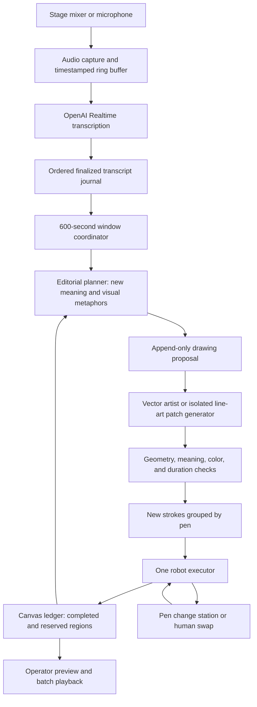
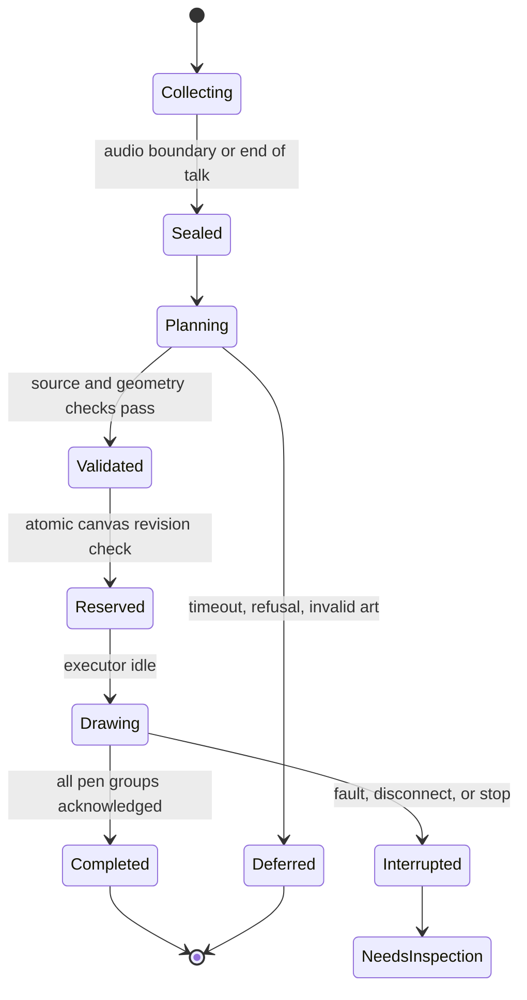

# Incremental explanatory doodles every ten minutes

## The design decision

The robot draws an evolving physical canvas. Every 600 seconds, a planner receives
only newly finalized speech, previous context, and the current canvas state. It
proposes a small set of new explanatory drawings. Once a stroke reaches paper,
its position and appearance are permanent. The next update adds ink; it never
regenerates the entire picture.

The artwork uses **black, red, green, and blue pens, with no words or numerals**.
Black supplies recognizable outlines. Blue shows information or movement. Green
shows connections or outcomes. Red emphasizes a gesture or important change.
Color reinforces shape; the explanation must still work in monochrome.

The ten-minute timer controls **when new content is selected**. A new drawing starts
after planning, validation, and any active robot job finish. It does not appear
instantly at 10:00. The microphone records throughout drawing and pen changes.

## What is runnable now

```bash
uv run main.py storyboard test.txt output/my-ten-minute-replay --paper 250x250
```

Open `output/my-ten-minute-replay/index.html`. Use Next, Previous, Play batches,
New ink only, or Stroke order. The paper has no labels; controls and explanations
sit outside it. The source fixture contains **twelve vector doodles in eight
append-only batches**, authored by Codex in this session. No API key is required.

The replay compiles the supplied plans, checks geometry and source evidence, and
exports each batch's new G-code separately. It also exports cumulative SVG/PNG
snapshots and each planner's input. It does not capture live audio, invoke an AI
model automatically, connect to a robot, or claim that the physical strokes were
drawn. Its artwork demonstrates the incremental drawing contract; it is not a
trace of the earlier generated raster concept.

`talk` runs this architecture end to end from a transcript or live speech, with
Codex planning each window automatically; see the README.

The existing `live` command remains the earlier small-icon prototype. The new
`storyboard` command demonstrates this ten-minute architecture separately, so the
different cadence, artwork, and physical-state rules are explicit.

## Example timing from test.txt

The source has no timestamps. After removing its wrapper, page credits, speaker
headings, and standalone stage directions, it contains **10,658 words**. The demo
assumes 150 words/minute, which gives 71:03 of synthetic speech. Actual keynote
timing differs because of pauses, demos, audience reactions, and speaker changes.
Production windows use audio timestamps, never word count.

| Speech received | Drawings added | Cumulative count |
|---|---|---:|
| 00:00–10:00 | Three streams become one phone; fingers conduct controls; personal media travel from laptop to phone | 3 |
| 10:00–20:00 | Phone mirrors its user; a fingertip sets music in motion | 5 |
| 20:00–30:00 | People join one conversation; choose one message from a hanging line | 7 |
| 30:00–40:00 | Browser shutters open onto the world | 8 |
| 40:00–50:00 | A map route becomes coffee steam | 9 |
| 50:00–60:00 | A melody passes through a call and shared photo, then resumes | 10 |
| 60:00–70:00 | A calendar launches a paper plane toward a target | 11 |
| 70:00–71:03, end-of-talk flush | A skater aims where the puck will go | 12 |

Each quotation supporting a drawing must occur in that batch's source window.
For example, the coffee/map scene cannot appear in the first ten minutes. A
quotation match is an evidence check, not a proof of semantic correctness; a
production planner still needs an entailment/quality check.

The demo reserves one central region and eleven surrounding regions. Only empty
geometry is reserved in advance, not future subject matter. The center is drawn
after the initial three-in-one reveal. Later regions can acquire any meaning
supported by later speech. A production layout allocator should select a fitting
empty region dynamically instead of relying on the fixture's authored placement.

## End-to-end architecture



Audio capture and inference run outside the robot's control process. The robot
process receives validated paths only. A slow API response must never interrupt
the motion driver, stop audio ingestion, or cause old G-code to be replayed.

### 1. Capture and finalized transcript journal

Use the sound desk's direct output when available. Capture with monotonic local
timestamps and retain a bounded audio ring buffer for reconnects. Persist received
transcript events with session ID, audio interval, item ID, content index, revision,
text, and whether they are final. Deltas may update an operator transcript, but
only completed segments enter a drawing window.

OpenAI's Realtime transcription API provides delta and completion events. Different
turns can complete out of order, so assemble them using their item identities and
the locally tracked audio order, not response arrival order. See the
[official Realtime transcription guide](https://developers.openai.com/api/docs/guides/realtime-transcription).

Deduplicate by session/item/content identity. A reconnect must not create a second
drawing for the same speech. Mark missing audio intervals explicitly. Never invent
what the audience may have said during a network gap.

### 2. Window coordinator

Anchor boundaries to the session's audio clock: 600, 1200, 1800 seconds, and so on.
Do not restart the timer whenever a model or robot finishes. At each boundary:

1. Close the source interval. Allow a small, bounded finalization grace period
   (initial target: five seconds) for already recorded audio.
2. Assign finalized segments by their audio end timestamp. A segment crossing a
   boundary belongs wholly to the following window, avoiding duplicate phrases.
3. Persist the source watermark, ordered text, hash, and immutable batch ID.
4. Send the new text, rolling past-only summary, and canvas ledger to the planner.
5. Keep recording into the next interval while planning and drawing continue.

Late transcription after a window is sealed is carried forward with its source
time and a late flag. Never rewrite a batch that has started drawing. On explicit
end of talk, flush the final partial interval. Quiet/repetitive windows can produce
zero new drawings; the update still records a no-op revision.

With this cadence, the first ten minutes are a listening period. A startup drawing
would be a separate behavior and is not included. The robot may also park between
batches if the useful drawings finish early. Continuous useful motion is not
guaranteed by a ten-minute update schedule.

### 3. Editorial planner

Use an OpenAI Responses request with a structured output schema. Give it:

- The sealed window's speech and timestamps, plus a compact summary of earlier speech.
- Prior illustrated concepts and entity relationships, so repetition adds no duplicate ink.
- Existing artwork preview, immutable element IDs, reserved boxes, and safe connector ports.
- Available colors, no-text requirement, pen width, available space, and drawing-time budget.

Return zero to three candidate explanations with source evidence, a visual
metaphor, affected entity IDs, suggested placement, priority, and simple optional
details. Ask for a relationship or action, not a noun pictogram. For example,
"music, calls, and the internet in one device" becomes three streams joining one
doorway; "visual voicemail" becomes choosing one hanging message out of order.

Do not give the planner the full transcript file in replay mode. Its prompt is
the generated `NN-planner-input.json`, which contains the current window and past
state only. In this demo, the fixtures are preauthored and evidence-validated;
this is not a claim that an autonomous model was tested without future context.

[Structured Outputs](https://developers.openai.com/api/docs/guides/structured-outputs)
can constrain response shape. Local code must still validate evidence, spatial
bounds, drawability, duration, refusals, and incomplete or failed responses.

### 4. Composition and the artist

Maintain a scene graph: entities, their existing illustrations, relationships,
attachment points, and empty regions. The allocator reserves a new region before
the artist starts. Include pen-width and tracking-error clearance. A connector
may end at a predefined free port but must not run through previous ink.

For the keyless prototype, Codex authors cubic/quadratic SVG paths inside local
0–100 coordinates. The compiler places them once into fixed paper millimeters.
The drawing contract contains only pen names and geometry, never executable code
or robot coordinates supplied directly to the controller.

For higher artistic quality later, an OpenAI image generation call can create
**only the new isolated line-art patch**, using prior artwork as a style reference.
Centerline-vectorize the patch, fit it into the reserved region, simplify it, and
quantize it to the four physical pens. Verify that thin details remain readable at
the actual size. Reject text, lettering disguised as paths, fills, shadows, and
excessively dense detail. See the [official image-generation guide](https://developers.openai.com/api/docs/guides/image-generation).

The model never replaces the complete canvas. Even if an image-edit endpoint is
used, extract and validate only the reserved new region; preserve old vector data
exactly. Image consistency promises or edit masks are not an adequate physical
ink preservation mechanism.

The earlier `image --one-line` route makes a wandering tonal drawing from a raster.
That is a different visual style. It should not substitute for centerline tracing
of these sparse explanatory strokes. The image-generation/centerline adapter is
future work, not part of the current runnable replay.

### 5. Validation and physical planning

Before reserving execution:

- Check source window/hash and base canvas revision; reject stale proposals.
- Check unique element IDs and no overlap with existing or reserved regions.
- Accept only black, red, green, and blue, and finite, bounded path geometry.
- Enforce no text and no fills. Current fixture validation rejects text elements;
  future model output additionally needs visual checking for lettering represented
  as curves.
- Flatten curves, transform into paper coordinates, and run the existing paper
  bounds check. Do not re-fit the cumulative drawing to fill the page.
- Estimate all pen-down travel, pen-up travel, lifts, tool changes, and settling.
- Keep the drawing budget below 80% of the 600-second interval initially, leaving
  120 seconds for generation, validation, and timing uncertainty. This is a budget,
  not a measured latency guarantee.

The demo uses 1000 mm/min drawing feed, 3000 mm/min travel, a 2 mm lift, an assumed
20 seconds per pen load, and extra travel/settling allowances. The first batch's
estimate is roughly 306 seconds; later batches are smaller. Estimates do not
validate reachability, calibration, line tracking, or real pen-change duration.
The arm's documented several-millimeter tracking errors make tiny details risky;
physical scale and speed need a measured drawing test before production use.

Essential contours execute before optional details. If a candidate is too slow,
remove optional details or fewer important concepts before committing any ink.
Do not speed the robot past its validated limit just to meet a deadline.

### 6. Four pens and execution

Batch paths by pen to limit tool changes. The fixture uses a stable tool table:

| Tool | Pen | Preview color |
|---|---|---|
| T1 | Black | `#231F20` |
| T2 | Blue | `#1B4F9C` |
| T3 | Green | `#00843D` |
| T4 | Red | `#D52B1E` |

Each delta G-code file includes its tool table and `M6` pen changes. The existing
driver handles those by lifting and waiting for a human to change the pen. A live
unattended performance with all four colors therefore needs a calibrated automatic
pen changer or an operator. Software alone cannot remove this dependency. Operator
confirmation must not be replaced by a short timeout unless the real swap process
is already reliable. Audio capture continues during the swap.

Only one executor owns the robot. It reads one validated job, confirms the selected
pen and paper calibration, and uses the existing motion driver. The prototype
exports jobs but never sends them automatically. If testing later, send only the
individual `NN-additions.gcode` in order, once each, with the measured paper origin
and pen offset. The cumulative SVG is for preview; do not redraw it over the paper.

### 7. Persistent canvas ledger and recovery

Use a local SQLite database in the production coordinator. A single process can
own it; no distributed message system is needed for one stage and one robot.

| Record | Essential fields |
|---|---|
| Session | ID, paper calibration, palette, pen widths, clock origin, transcript mode |
| Transcript item | Audio start/end, item/content IDs, final text, revision, gap flags |
| Window | ID, boundary times, sealed text hash, source watermark, partial/no-op flags |
| Proposal | Window ID, base revision, response hash, evidence, model/prompt version |
| Element | Stable ID, parent/topic, region, connector ports, stroke/pen hash, status |
| Draw job | ID, ordered path hashes, time budget, pen groups, current checkpoint |
| Event | Monotonic sequence, time, job/stroke ID, started/completed/error observation |

State transitions:



Reserved, started, and completed regions all block conflicting placements. A
model timeout can be retried before reservation using the same batch identity.
After drawing starts, the batch's geometry and position are locked. Record a
stroke-start event before issuing motion and a completion event after success.

A crash between physical motion and acknowledgement is ambiguous. Do not promise
exactly-once ink: stop and inspect uncertain strokes instead of blindly redrawing
the job. Treat an interrupted region as occupied until reconciled. Physical paper
identity must match the ledger when resuming.

Maintain at most one active job and one pending job. If generation falls behind,
combine unillustrated concepts from newer windows into the next pending proposal;
do not lose the underlying transcript. A proposal being replaced must not have
started drawing. Revalidate its canvas revision and release its old reservations
transactionally. Never interrupt a stroke to chase a new topic.

## Codex now; OpenAI API later

For this task, Codex authored the eight JSON plans and their vector artwork. The
replay uses those files, with no external inference requests. This proves the
window boundaries, no-text/four-pen output, fixed geometry, and delta export.

For an automated development planner, the installed Codex CLI is signed in with
ChatGPT. Its documented non-interactive mode supports structured outputs and
reuses saved authentication. A per-window invocation can use a prompt containing
only the current input and output schema:

```bash
codex exec --sandbox read-only --ephemeral \
  --output-schema examples/keynote/plan.schema.json \
  -o output/candidate-plan.json - < output/window-prompt.txt
```

The prompt must explain the schema and include the current window/context. Run it
from a dedicated planner workspace containing only the current request, the
schema, and past state; do not place a future transcript there. Validate the result
before accepting it. No model-generated shell code should become a motion job.
Codex is an authoring bridge with account usage limits, not a free, guaranteed
production inference endpoint. The automatic invocation above is documented here;
the replay does not invoke it or claim it was end-to-end tested. See
[OpenAI Docs: non-interactive Codex](https://learn.chatgpt.com/docs/non-interactive-mode).

Once an API key is available, replace the planner call with a server-side Responses
request, and connect Realtime transcription to the window journal. Keep the same
window IDs, evidence contract, reservations, vector validation, and robot executor.
Use configurable model names selected from supported models at integration time.
Do not put the API key in the browser or in a drawing plan. ChatGPT/Codex login is
not an API key for the Realtime or image-generation endpoints.

## Implementation map and completion criteria

| Piece | Current state |
|---|---|
| Transcript cleanup, synthetic 600-second windows, tail flush | Implemented in `svg_to_gcode/storyboard.py` |
| Twelve text-free RGB/black explanatory doodles | Codex-authored fixture in `examples/keynote/` |
| Evidence/hash/revision, region, palette, and path validation | Implemented for the fixture contract |
| Immutable cumulative SVG and delta G-code | Implemented and tested |
| Serial timing estimates and keyless interactive replay | Implemented; does not simulate arm dynamics |
| Live API transcription and persistent coordinator | `talk` windows local whisper.cpp speech by capture time; Realtime API and SQLite ledger not implemented |
| Automatic Codex or Responses planner | `talk` runs `codex exec` per window with a strict schema and per-doodle validation; Responses API not wired |
| Image patch generation and centerline vectorization | Architecture defined; not implemented |
| Persistent execution ledger and crash reconciliation | Architecture defined; not implemented |
| Automatic four-pen changer | Hardware integration required; driver currently supports human swaps |

Before a stage run, prove: a recorded timed talk produces no future-aware drawing;
earlier vector hashes never change; simulated pen-tip bounds and duration fit;
microphone capture survives long model calls; duplicate events do not duplicate
jobs; a mid-stroke disconnect stops without automatic redraw; and a real four-pen
sample reaches the required visual quality and tracking accuracy.
